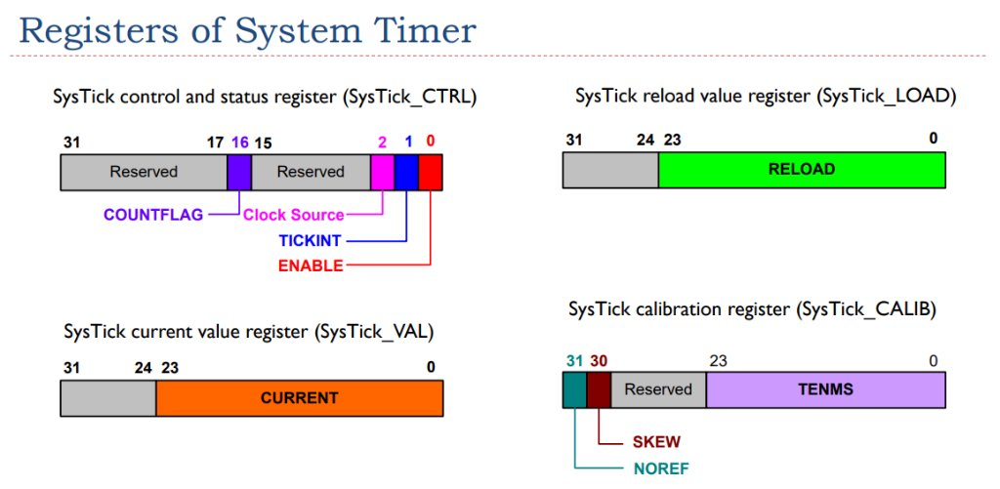

# Registers of System Timer (SysTick)

## SysTick Register Details

### 1. SysTick Control and Status Register (`SysTick_CTRL`)
- **ENABLE** (Bit 0): Enables the SysTick counter (1 = Enable, 0 = Disable).
- **TICKINT** (Bit 1): Enables SysTick exception interrupt when the counter reaches 0 (1 = Enable interrupt, 0 = Disable).
- **Clock Source** (Bit 2): Selects the clock source (0 = External reference clock, 1 = Processor clock).
- **COUNTFLAG** (Bit 16): Returns 1 if timer counted to 0 since last read. Reading this register automatically clears this bit to 0.

### 2. SysTick Reload Value Register (`SysTick_LOAD`)
- **RELOAD** (Bits 23:0): Value to load into the SysTick Current Value Register (`SysTick_VAL`) when the counter reaches 0.

### 3. SysTick Current Value Register (`SysTick_VAL`)
- **CURRENT** (Bits 23:0): Current counter value. Writing any value clears the register to 0 and clears the `COUNTFLAG` bit in `SysTick_CTRL`.

### 4. SysTick Calibration Register (`SysTick_CALIB`)
- **TENMS** (Bits 23:0): Reload value for a 10ms timing interval.
- **SKEW** (Bit 30): 1 if the 10ms calibration value is not exact.
- **NOREF** (Bit 31): 1 if no external reference clock is available.
